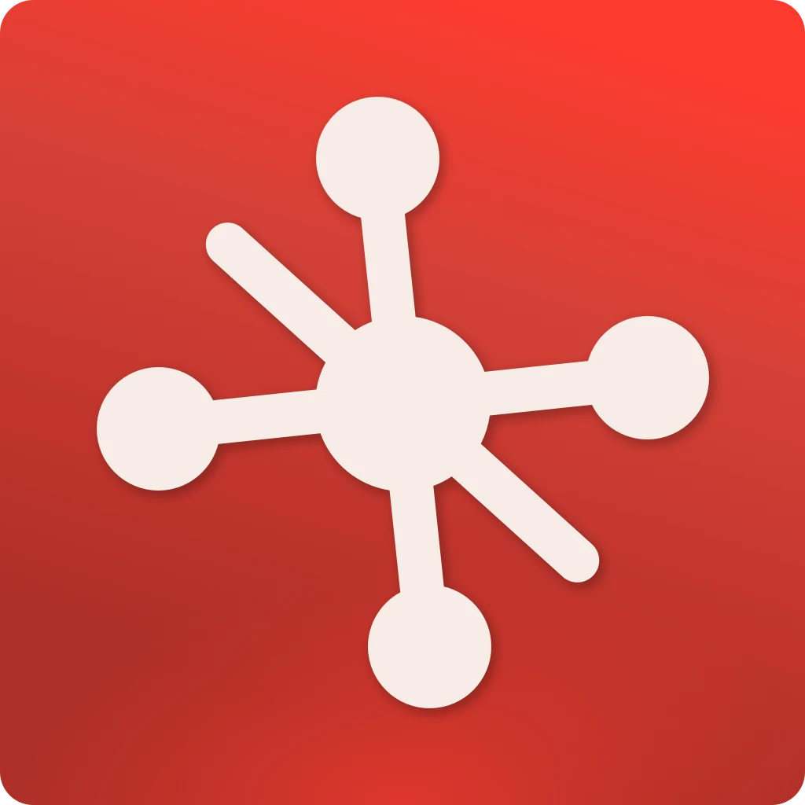
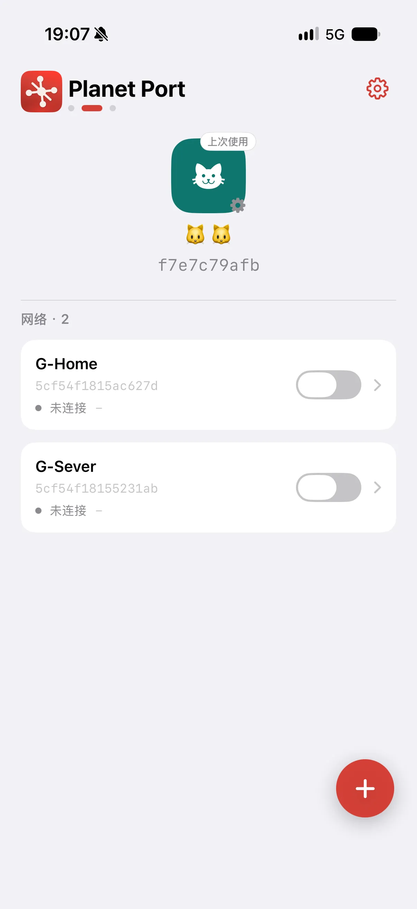
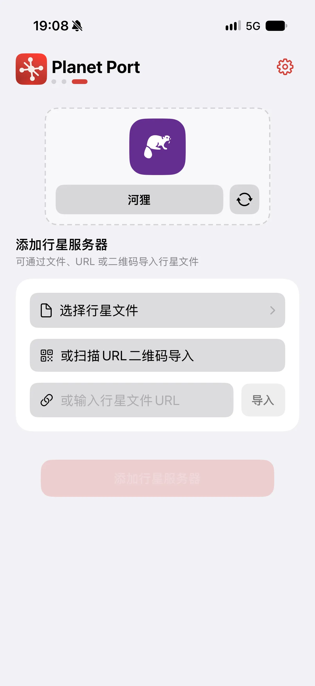
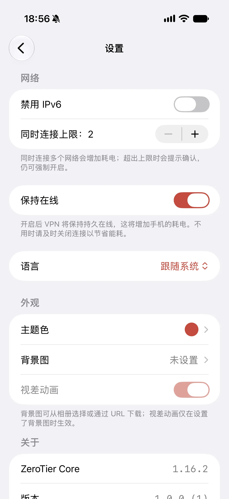
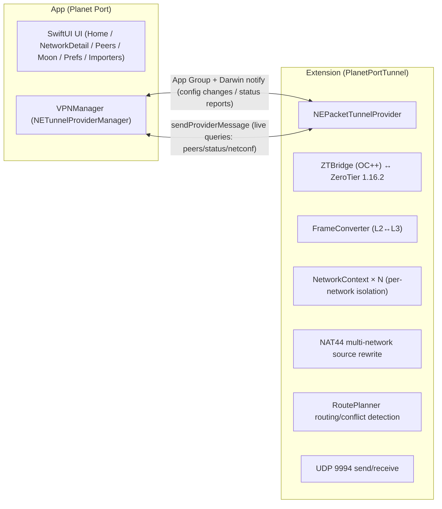

<p align="center">
  
</p>

# Planet Port 🪐

[简体中文](README.md) | [繁體中文](README.zh-Hant.md) | English

**Planet Port** is an open-source ZeroTier client for iOS, built on the official ZeroTier 1.16 core. It brings overlay networking to your iPhone / iPad: run multiple Planets side by side (official + self-hosted private Planets), connect to several networks at once, and take full control of the default route and DNS. Native SwiftUI, free and open source — an advanced alternative to the official ZeroTier One app.

> Unofficial client. Not affiliated with ZeroTier, Inc.

## Highlights

- **Multi-Planet management** — keep the official and multiple private Planets side by side; import via file, URL or QR code
- **Multi-network connectivity** — soft limit (default 2, adjustable 2–6) with explicit confirmation; address/subnet conflicts are detected automatically and disconnected
- **Full network management** — join/leave networks with live status, one-tap managed-IP copy
- **Default route & three DNS modes** — route-through-ZT toggle, DNS network-provided / custom / none, all hot-reconfigured inside the tunnel, no reconnect needed
- **Theming** — custom UI color; the whole visual system (including planet decorations and status colors) derives from your main color

## Screenshots

<p align="center">
  
  
  
</p>

## Getting Started

> **Requirements**: iOS 17 or later. For iOS 16 devices (e.g. iPhone X), build from the [ios16 compatibility branch](https://github.com/planet-port/planet-port-ios/tree/planet-port-ios--ios16) instead — kept feature-parallel.

```bash
brew install xcodegen   # first time
./scripts/bootstrap.sh
open PlanetPort.xcodeproj
```

`bootstrap.sh` fetches the ZeroTier core sources and generates the Xcode project. The core sources are downloaded from a pinned tag (SHA256-verified) into `Core/` (gitignored, never committed), cached under `~/Library/Caches/PlanetPort/` — reruns are instant. If the download fails:

```bash
# use a mirror
ZT_TARBALL_URL=<mirror-url> ./scripts/bootstrap.sh
# or download the tarball manually into the cache directory and rerun (works offline once verified)
mkdir -p ~/Library/Caches/PlanetPort
cp ZeroTierOne-1.16.2.tar.gz ~/Library/Caches/PlanetPort/
```

To upgrade the ZeroTier version: update `ZT_VERSION` and `ZT_SHA256` in `scripts/bootstrap.sh` and rerun.

## Basic Usage

1. **Install**: after generating the project in "Getting Started", select your own development team in Xcode for both targets (the main app and the tunnel extension) → Cmd+R on device. A personal (free) Apple developer account is enough.
2. **Join a network**: add a Planet on the home page (or use the official one) → enter the 16-digit network ID → authorize the new node at [ZeroTier Central](https://my.zerotier.com) → the status turns "online" and you're connected.
3. **Switch Planets**: import a private Planet file/URL → swipe between planets on the home page → flip on one of its networks to switch the tunnel.
4. **Stay connected**: enable "Stay Connected" in Settings; connections survive network changes.

## Architecture



- **Core**: the ZeroTier 1.16.2 C API runs inside the extension process; stateGet/statePut land in the App Group container
- **Planet isolation**: `ZT_STATE_OBJECT_PLANET` is redirected per current config; Network/Moon/Peer core caches live in per-Planet directories
- **Multi-network data plane**: a single tun carries multiple networks; NetworkContext isolates MAC/addresses/ARP/NDP/routes per network; the iOS single-tun multi-address source-selection flaw is fixed by NAT44 rewriting source/destination addresses in the data plane; RoutePlanner builds tunnel routes and detects subnet conflicts
- **Frame semantics**: C API frames carry no Ethernet header (MAC/etherType are separate parameters); FrameConverter bridges them to NEPacketTunnelProvider L3 IP packets, with pure-software ARP/NDP tables

### Layout

- `Core/` — ZeroTier 1.16.2 core sources (fetched at build time from the official tag by `scripts/bootstrap.sh`, not committed)
- `ZTBridge/` — OC++ bridging layer (C API ↔ Swift)
- `PlanetPortTunnel/` — tunnel extension (frame conversion, UDP, background task driving)
- `Shared/` — shared between App/Extension (App Group, config storage, IPC models, status)
- `PlanetPort/` — the main app (UI, VPNManager, importers)

## Acknowledgements

- [ZeroTier](https://github.com/zerotier/ZeroTier) — the network core
- Some animal icons are from [Material Design Icons](https://pictogrammers.com/) (Pictogrammers Free License) and [Font Awesome Free](https://fontawesome.com/) (CC BY 4.0; Icons by Font Awesome).

## Donate

If Planet Port helps you, consider buying the author a coffee ☕

**BTC** (Taproot)

```
bc1p5426677uuazuvfy9fptmczv4zwv550qlu9umw9jyptw5q7ln420qe03ae6
```

**ETH** (Ethereum)

```
0xbaa7a263a95bddb2ff364d1c47e385ed9f54a66a
```

**SOL** (Solana)

```
CFjZhq1dYdQCFKgkhbBwQEzg21WKwoNAm9KZ9uk2nJyf
```
