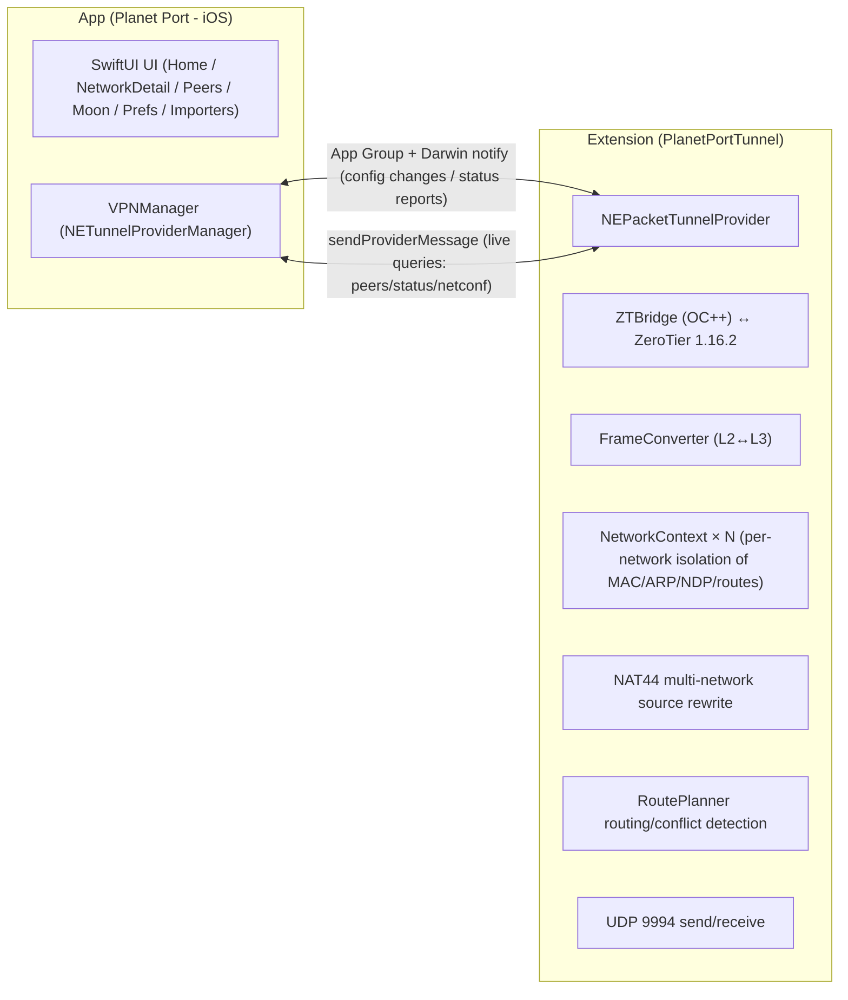

<p align="center">
  
</p>

# Planet Port - iOS 🪐

[简体中文](README.md) | [繁體中文](README.zh-Hant.md) | English

**Planet Port** is an open-source ZeroTier client for iOS, built on the official ZeroTier 1.16.2 core and written in native SwiftUI. It manages Planets and networks on your iPhone / iPad: multiple Planets side by side, several networks connected at once, with full control over the default route and DNS.

Planets import via file, URL or QR code, and share via file or QR code. The official Planet and self-hosted private Planets share the same home page — swipe to switch, and the tunnel follows instantly.

Free and open source — possibly the best-looking ZeroTier client around, and the one that takes Planet management most seriously. An advanced alternative to the official ZeroTier One app.

> Unofficial client. Not affiliated with ZeroTier, Inc.

## Origin

I've been running my own private network on ZeroTier for almost three years. What impressed me most is "configure once, use invisibly" — it never gets in your way, yet it's everywhere, letting you reach your home devices from anywhere.

On Android, ZerotierFix lets you customize the Planet; iOS has long lacked a comfortable client, and reaching the home network was always a hassle. So I built this one, with extra care put into Planet management and sharing — that's Planet Port.

## Features

### Planet management

- **Multiple Planets side by side** — manage the official Planet together with multiple private ones; the tunnel applies exactly one at a time
- **Import** — Planet file, file URL, or QR code. QR transfer uses dynamic chunking with adaptive capacity, so even large files go through; scanning supports live camera and photo-library recognition
- **Share** — file or QR code; device-to-device transfer in seconds
- **A Planet is a world** — each Planet gets its own cache, isolated in per-Planet directories; switching Planets never mixes data
- **Cross-Planet switching** — confirm the disconnect first, then start the new tunnel, through a custom in-app dialog flow that stays under your control
- **Duplicate protection** — deduplicated by World ID; the same Planet can't be added twice

### Network connectivity

- **Multi-network** — a single tunnel carries multiple networks; the soft limit defaults to 2 and is adjustable from 2–6, with explicit confirmation required beyond it
- **Automatic conflict disconnect** — address or subnet conflicts are detected and disconnected automatically, with the reason shown right on the network card
- **Toggle to connect** — the toggle on each network row applies the tunnel config directly; pending states are visible in real time
- **Fine-grained status** — initializing → connecting → online, each stage clearly labeled; timed-out connections drop automatically (threshold configurable); airplane mode shows "no network" instantly
- **Join networks** — enter a 16-digit network ID or scan a QR code; authorize the new node at [ZeroTier Central](https://my.zerotier.com) and you're connected
- **One-tap copy** — managed IPs, node ID and network ID copy on tap; the network ID is also available as a QR code

### Routing & DNS

- **Default route** — a single "route through ZeroTier" toggle sends all traffic through the tunnel
- **Three DNS modes** — network-provided / custom / none
- **Hot reconfiguration** — every routing or DNS change happens inside the tunnel; no disconnect and reconnect needed
- **IPv6** — can be disabled on demand

### Peers

- **Live peer list** — latency shown in semantic colors (<30ms green / <100ms orange / ≥100ms red), marked "relay" when no direct path exists

### Experience

- **Stay connected** — connections auto-restore on network changes (Wi-Fi/cellular switches)
- **Theming** — pick a main color on an HSL wheel; planet decorations and status colors derive from it globally
- **Background parallax** — custom background image with a CoreMotion gravity-driven parallax animation; can be turned off
- **Localization** — Simplified Chinese, Traditional Chinese and English
- **Data-plane diagnostics** — in/out traffic, ARP question/answer counts, no-route drops and an event log for troubleshooting


## Getting Started

1. **Join a network**: add or pick a Planet on the home page (the official one works out of the box) → "Add Network" with a 16-digit ID or a QR scan → authorize the new node at ZeroTier Central → the status turns "online" and you're connected.
2. **Switch Planets**: import a private Planet (file / URL / QR code) → swipe on the home page → flip on a network under it; the tunnel switches to the new Planet right away.
3. **Stay connected**: enable "Stay Connected" in Settings; connections survive network changes.

## Screenshots

<p align="center">
  
  
  
</p>

## Build from Source

> **Requirements**: iOS 17 or later. For iOS 16 devices (e.g. iPhone X), build from the [ios16 compatibility branch](https://github.com/planet-port/planet-port-ios/tree/planet-port-ios--ios16) instead — kept feature-parallel.

```bash
brew install xcodegen   # first time
./scripts/bootstrap.sh
open PlanetPort.xcodeproj
```

`bootstrap.sh` fetches the ZeroTier core sources and generates the Xcode project: the core sources are downloaded from a pinned tag (SHA256-verified) into `Core/` (gitignored, never committed) and cached under `~/Library/Caches/PlanetPort/` — reruns are instant.

If the download fails, there are two ways out:

```bash
# use a mirror
ZT_TARBALL_URL=<mirror-url> ./scripts/bootstrap.sh

# or drop the tarball into the cache directory and rerun (works offline once verified)
mkdir -p ~/Library/Caches/PlanetPort
cp ZeroTierOne-1.16.2.tar.gz ~/Library/Caches/PlanetPort/
```

To upgrade the ZeroTier version: update `ZT_VERSION` and `ZT_SHA256` in `scripts/bootstrap.sh` and rerun.

## Architecture



- **Process model** — the app handles UI and VPN orchestration (VPNManager), while the ZeroTier 1.16.2 C API runs in the tunnel extension process; both sides share config through the App Group and communicate both ways via Darwin notify and sendProviderMessage
- **Planet isolation** — `ZT_STATE_OBJECT_PLANET` is redirected per current config; Network / Moon / Peer core caches live in per-Planet directories
- **Multi-network data plane** — a single tun carries multiple networks; NetworkContext isolates MAC / addresses / ARP / NDP / routes per network; the iOS single-tun multi-address source-selection flaw is fixed by NAT44 rewriting source/destination addresses in the data plane; RoutePlanner builds tunnel routes and detects subnet conflicts
- **Frame semantics** — C API frames carry no Ethernet header (MAC and etherType are separate parameters); FrameConverter bridges them to NEPacketTunnelProvider L3 IP packets, with pure-software ARP/NDP tables

### Layout

- `Core/` — ZeroTier 1.16.2 core sources (fetched at build time from the official tag by `scripts/bootstrap.sh`, not committed)
- `ZTBridge/` — OC++ bridging layer (C API ↔ Swift)
- `PlanetPortTunnel/` — tunnel extension (frame conversion, UDP, background task driving)
- `Shared/` — shared between App and extension (App Group, config storage, IPC models, status)
- `PlanetPort/` — the main app (UI, VPNManager, importers)
- `Modules/QRTransfer/` — QR code chunked transfer

### Further reading

- [DESIGN.md](DESIGN.md) — visual and component design anchor
- [docs/PlanetPort.md](docs/PlanetPort.md) — product structure and page responsibilities
- [docs/多网络数据面.md](docs/多网络数据面.md) — multi-network data plane NAT design and known limitations
- [CHANGELOG.md](CHANGELOG.md) — release notes

## Acknowledgements & Licenses

- [ZeroTier](https://github.com/zerotier/ZeroTierOne) — the network core, MPL-2.0; license text at [docs/licenses/ZeroTierOne-MPL-2.0.txt](docs/licenses/ZeroTierOne-MPL-2.0.txt)
- The app itself is [MIT](LICENSE) licensed
- Some animal icons are from [Material Design Icons](https://pictogrammers.com/) (Pictogrammers Free License), [Font Awesome Free](https://fontawesome.com/) (CC BY 4.0; Icons by Font Awesome) and [game-icons](https://game-icons.info/) (Lorc, Delapouite and other authors, CC BY 3.0); all icon assets have been recolored and re-encoded

## Donate

If Planet Port helps you, consider buying the author a coffee ☕

**BTC** (Taproot)

```
bc1p5426677uuazuvfy9fptmczv4zwv550qlu9umw9jyptw5q7ln420qe03ae6
```

**ETH** (Ethereum)

```
0xbaa7a263a95bddb2ff364d1c47e385ed9f54a66a
```

**SOL** (Solana)

```
CFjZhq1dYdQCFKgkhbBwQEzg21WKwoNAm9KZ9uk2nJyf
```
