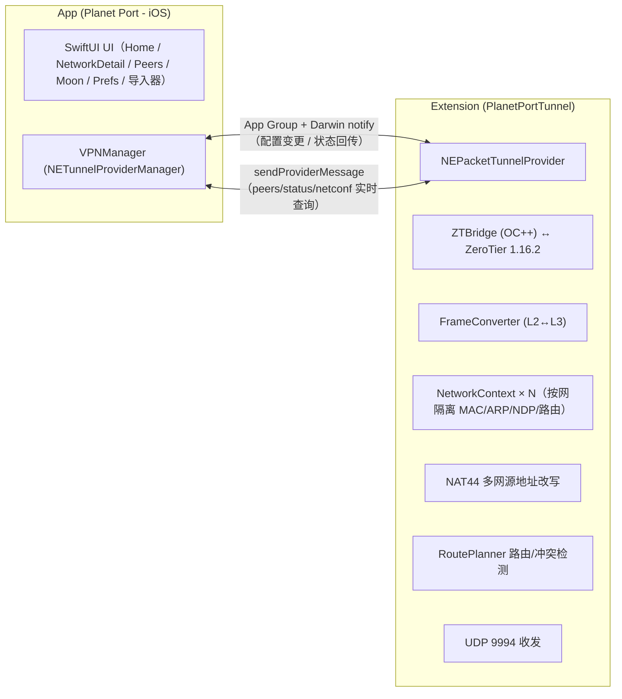

<p align="center">
  
</p>

# Planet Port - iOS 🪐

简体中文 | [繁體中文](README.zh-Hant.md) | [English](README.en.md)

**Planet Port - iOS** 是一款开源的 iOS ZeroTier 客户端，基于 ZeroTier 1.16 官方核心打造。它让你在 iPhone / iPad 上轻松完成异地组网与虚拟局域网管理：多 Planet 并存（官方 + 自建私有 Planet），多网络同时连接，默认路由与 DNS 全自由掌控。原生 SwiftUI 实现，免费开源，是官方 ZeroTier One App 之外的进阶之选。

> 非官方客户端，与 ZeroTier, Inc. 无隶属关系。

## 特色

- **多 Planet 管理**：官方与多份私有 Planet 并存。可通过文件/URL，二维码方式导入
- **多网络同时连接**：软上限（默认 2，可调 2–6）带确认放行；地址/网段冲突自动检测并断开
- **完整网络管理**：加入/退出网络，实时状态提示，managed IP 一键复制
- **默认路由与 DNS 三模式**：经 ZT 路由开关、DNS 网络下发/自定义/不使用，全部隧道内热重配，无需重连
- **主题定制**：自定义UI颜色，主色派生全局视觉（含行星装饰盘与状态色）

## 截图

<p align="center">
  
  
  
</p>

## 快速开始

> **系统要求**：iOS 17 及以上。iOS 16 设备（如 iPhone X）请改用 [ios16 兼容分支](https://github.com/planet-port/planet-port-ios/tree/planet-port-ios--ios16) 构建，功能同步维护。

```bash
brew install xcodegen   # 首次
./scripts/bootstrap.sh
open PlanetPort.xcodeproj
```

`bootstrap.sh` 会自动拉取 ZeroTier 核心源码并生成 Xcode 工程。核心源码按固定 tag 下载（含 SHA256 校验）到 `Core/`（已 gitignore，不入库），缓存于 `~/Library/Caches/PlanetPort/`，重跑秒过。下载失败时：

```bash
# 换镜像
ZT_TARBALL_URL=<镜像地址> ./scripts/bootstrap.sh
# 或浏览器手动下载 tarball 放到缓存目录后重跑（校验通过即离线使用）
mkdir -p ~/Library/Caches/PlanetPort
cp ZeroTierOne-1.16.2.tar.gz ~/Library/Caches/PlanetPort/
```

升级 ZeroTier 版本：修改 `scripts/bootstrap.sh` 中的 `ZT_VERSION` 与 `ZT_SHA256` 后重跑。

## 核心用法

1. **安装**：见「快速开始」生成工程后，在 Xcode 为两个 target（主 App 与 tunnel extension）选择自己的开发团队 → 真机 Cmd+R。个人（免费）Apple 开发者账号即可。
2. **加入网络**：首页添加行星（或使用官方 Planet）→ 输入 16 位网络 ID → 到 [ZeroTier Central](https://my.zerotier.com) 授权新节点 → 状态变「在线」即互通。
3. **切换 Planet**：导入私有 Planet 文件/URL → 首页左右翻页切换行星 → 打开其下网络开关即切换隧道。
4. **保持在线**：设置页开启"保持在线"，网络变化自动恢复连接。

## 架构



- **核心**：ZeroTier 1.16.2 C API 跑在 extension 进程，stateGet/statePut 落 App Group 容器
- **Planet 隔离**：`ZT_STATE_OBJECT_PLANET` 按当前配置重定向；Network/Moon/Peer 核心缓存按 Planet 分目录
- **多网络数据面**：单 tun 承载多网络，NetworkContext 按网络隔离 MAC/地址/ARP/NDP/路由；iOS 单 tun 多地址源选择缺陷由 NAT44 在数据面改写出入站源/目的地址修复；RoutePlanner 生成隧道路由并检测网段冲突
- **帧语义**：C API 帧不含以太网头（MAC/etherType 为独立参数），FrameConverter 负责与 NEPacketTunnelProvider 的 L3 IP 包互转，ARP/NDP 为纯软件表

### 目录

- `Core/` — ZeroTier 1.16.2 核心源码（构建时由 `scripts/bootstrap.sh` 按官方 tag 拉取，不入库）
- `ZTBridge/` — OC++ 桥接层（C API ↔ Swift）
- `PlanetPortTunnel/` — 隧道 extension（帧转换、UDP、后台任务驱动）
- `Shared/` — App/Extension 共用（App Group、配置存储、IPC 模型、状态）
- `PlanetPort/` — 主 App（UI、VPNManager、导入器）

## 致谢

- [ZeroTier](https://github.com/zerotier/ZeroTierOne) — 网络核心
- 部分动物图标来自 [Material Design Icons](https://pictogrammers.com/)（Pictogrammers Free License）与 [Font Awesome Free](https://fontawesome.com/)（CC BY 4.0，Icons by Font Awesome）。

## 捐赠

如果 Planet Port - iOS 帮到了你，欢迎请作者喝杯咖啡 ☕

**BTC**（Taproot）

```
bc1p5426677uuazuvfy9fptmczv4zwv550qlu9umw9jyptw5q7ln420qe03ae6
```

**ETH**（Ethereum）

```
0xbaa7a263a95bddb2ff364d1c47e385ed9f54a66a
```

**SOL**（Solana）

```
CFjZhq1dYdQCFKgkhbBwQEzg21WKwoNAm9KZ9uk2nJyf
```

