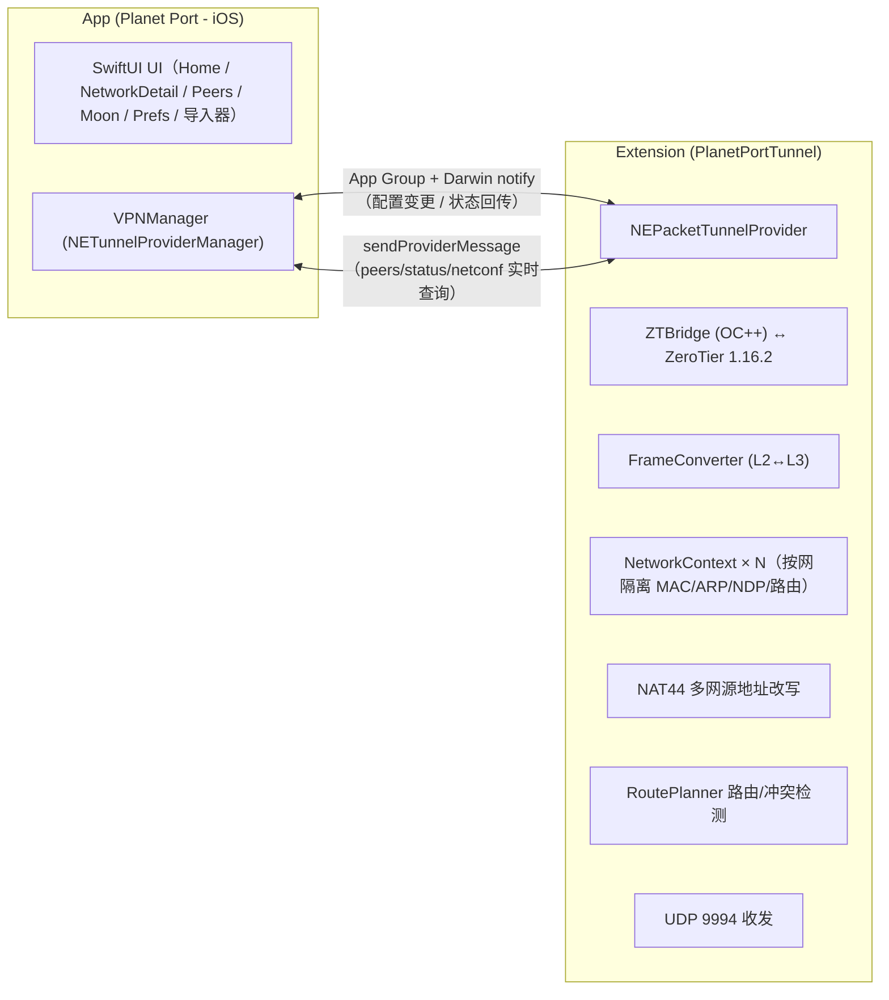

<p align="center">
  
</p>

# Planet Port - iOS 🪐

简体中文 | [繁體中文](README.zh-Hant.md) | [English](README.en.md)

**Planet Port** 是一款开源的 iOS ZeroTier 客户端，基于 ZeroTier 1.16.2 官方核心构建，原生 SwiftUI 写成。它在 iPhone / iPad 上管理行星（Planet）与网络：多颗行星并存，多个网络同时连接，默认路由与 DNS 均可控。

行星的导入支持文件、URL、二维码，分享支持文件、二维码；官方 Planet 与自建私有 Planet 在同一首页左右翻页，隧道随切换即时生效。

免费开源，可能是目前最好看、也最重视行星管理的 ZeroTier 客户端，官方 ZeroTier One App 之外的进阶之选。

> 非官方客户端，与 ZeroTier, Inc. 无隶属关系。

## 源起

用 ZeroTier 搭自己的私有网络快三年了。最深的感触是「一次配置，无感使用」——它不打扰，却又无处不在，到哪都能直连家里的设备。

Android 端有 ZerotierFix 可以自定义 Planet，iOS 却一直缺一个顺手的客户端，想访问家里网络总是很折腾。索性自己做了这一版，并把行星的管理与分享做得更细，就是现在的 Planet Port。

## 功能

### 行星（Planet）管理

- **多行星并存**：官方 Planet 与多份私有 Planet 一同管理，隧道同一时刻只应用一套
- **导入**：行星文件、文件 URL、二维码。二维码为动态分片传输，容量自适应，大文件也传得动；扫码支持相机实时扫描与相册图片识别
- **分享**：文件、二维码，设备间互传只需几秒
- **行星即世界**：每 Planet 独立缓存，按行星分目录隔离，切换行星不串数据
- **跨行星切换**：先确认断开、再启动新隧道，自绘弹窗流程，过程可控
- **查重保护**：按 World ID 去重，同一颗行星无法重复添加

### 网络连接

- **多网络同连**：单条隧道承载多个网络，软上限默认 2 条，可在 2–6 之间调整；超出上限需确认放行
- **冲突自动断开**：地址或网段冲突自动检测并断开，网络卡片直接显示冲突原因
- **开关即连接**：网络行的开关直接应用隧道配置，pending 状态实时可见
- **状态细化**：正在初始化 → 连接服务器 → 在线，每个阶段都有明确文案；连接超时自动断开（阈值可配置），飞行模式断网即时提示「无网络」
- **加入网络**：输入 16 位网络 ID 或扫码加入，到 [ZeroTier Central](https://my.zerotier.com) 授权新节点后即互通
- **一键复制**：managed IP、节点 ID、网络 ID 点击即复制，网络 ID 另支持二维码

### 路由与 DNS

- **默认路由**：「经 ZeroTier 路由」一键开关，全部流量走隧道
- **DNS 三模式**：使用网络下发 / 自定义 / 不使用
- **热重配**：路由与 DNS 的全部调整都在隧道内完成，不用断开重连
- **IPv6**：可按需禁用

### Peers

- **Peers 实时列表**：延迟按语义色呈现（<30ms 绿 / <100ms 橙 / ≥100ms 红），无直连路径时标注「中转 relay」

### 体验

- **保持在线**：开启后网络变化（Wi-Fi 与蜂窝切换）自动恢复连接
- **主题定制**：HSL 色盘自选主色，行星装饰盘与状态色由主色全局派生
- **背景视差**：自定义背景图，CoreMotion 重力驱动的背景视差动画。可关闭
- **多语言支持**：目前支持简体中文、繁體中文、English
- **数据面诊断**：出/入站流量、ARP 问答、无路由丢弃计数与事件日志，便于定位问题


## 上手使用

1. **加入网络**：首页添加或选择一颗行星（官方 Planet 开箱即用）→「添加网络」输入 16 位网络 ID，或扫码加入 → 到 ZeroTier Central 授权新节点 → 状态变「在线」即互通。
2. **切换行星**：导入私有 Planet（文件 / URL / 二维码）→ 首页左右翻页 → 打开该行星下的网络开关，隧道随即切换到新行星。
3. **保持在线**：设置页开启「保持在线」，网络变化自动恢复连接。

## 截图

<p align="center">
  
  
  
</p>

## 从源码构建

> **系统要求**：iOS 17 及以上。iOS 16 设备（如 iPhone X）请改用 [ios16 兼容分支](https://github.com/planet-port/planet-port-ios/tree/planet-port-ios--ios16) 构建，功能同步维护。

```bash
brew install xcodegen   # 首次
./scripts/bootstrap.sh
open PlanetPort.xcodeproj
```

`bootstrap.sh` 负责拉取 ZeroTier 核心源码并生成 Xcode 工程：核心源码按固定 tag 下载（含 SHA256 校验）到 `Core/`（已 gitignore，不入库），并缓存于 `~/Library/Caches/PlanetPort/`，重跑秒过。

下载失败时有两个办法：

```bash
# 换镜像
ZT_TARBALL_URL=<镜像地址> ./scripts/bootstrap.sh

# 或把 tarball 放进缓存目录后重跑（校验通过即离线使用）
mkdir -p ~/Library/Caches/PlanetPort
cp ZeroTierOne-1.16.2.tar.gz ~/Library/Caches/PlanetPort/
```

升级 ZeroTier 版本：修改 `scripts/bootstrap.sh` 中的 `ZT_VERSION` 与 `ZT_SHA256` 后重跑。

## 架构



- **进程模型**：App 负责 UI 与 VPN 编排（VPNManager），ZeroTier 1.16.2 C API 跑在隧道扩展进程；两侧经 App Group 共享配置，用 Darwin notify 与 sendProviderMessage 双向通信
- **行星隔离**：`ZT_STATE_OBJECT_PLANET` 按当前配置重定向；Network / Moon / Peer 核心缓存按行星分目录存放
- **多网络数据面**：单 tun 承载多网络，NetworkContext 按网络隔离 MAC / 地址 / ARP / NDP / 路由；iOS 单 tun 多地址源的选源缺陷由 NAT44 在数据面改写收发地址修复；RoutePlanner 生成隧道路由并检测网段冲突
- **帧语义**：C API 帧不含以太网头（MAC 与 etherType 是独立参数），FrameConverter 负责与 NEPacketTunnelProvider 的三层 IP 包互转，ARP / NDP 为纯软件表

### 目录

- `Core/` — ZeroTier 1.16.2 核心源码（构建时由 `scripts/bootstrap.sh` 按官方 tag 拉取，不入库）
- `ZTBridge/` — OC++ 桥接层（C API ↔ Swift）
- `PlanetPortTunnel/` — 隧道扩展（帧转换、UDP、后台任务驱动）
- `Shared/` — App 与扩展共用（App Group、配置存储、IPC 模型、状态）
- `PlanetPort/` — 主 App（UI、VPNManager、导入器）
- `Modules/QRTransfer/` — 二维码分片传输

### 延伸阅读

- [DESIGN.md](DESIGN.md) — 视觉与组件设计锚
- [docs/PlanetPort.md](docs/PlanetPort.md) — 产品结构与页面职责
- [docs/多网络数据面.md](docs/多网络数据面.md) — 多网络数据面 NAT 设计与已知限制
- [CHANGELOG.md](CHANGELOG.md) — 版本变更记录

## 致谢与许可

- [ZeroTier](https://github.com/zerotier/ZeroTierOne) — 网络核心，MPL-2.0，许可文本见 [docs/licenses/ZeroTierOne-MPL-2.0.txt](docs/licenses/ZeroTierOne-MPL-2.0.txt)
- App 本体采用 [MIT](LICENSE) 许可
- 部分动物图标来自 [Material Design Icons](https://pictogrammers.com/)（Pictogrammers Free License）、[Font Awesome Free](https://fontawesome.com/)（CC BY 4.0，Icons by Font Awesome）与 [game-icons](https://game-icons.info/)（Lorc、Delapouite 等作者，CC BY 3.0）；上述图标素材均经重新着色与格式转换

## 捐赠

如果 Planet Port 帮到了你，欢迎请作者喝杯咖啡 ☕

**BTC**（Taproot）

```
bc1p5426677uuazuvfy9fptmczv4zwv550qlu9umw9jyptw5q7ln420qe03ae6
```

**ETH**（Ethereum）

```
0xbaa7a263a95bddb2ff364d1c47e385ed9f54a66a
```

**SOL**（Solana）

```
CFjZhq1dYdQCFKgkhbBwQEzg21WKwoNAm9KZ9uk2nJyf
```
