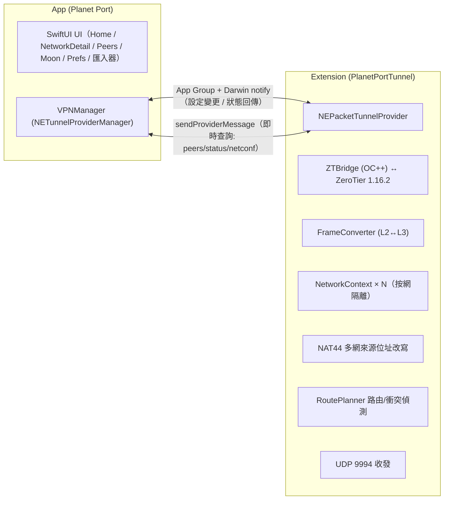

<p align="center">
  
</p>

# Planet Port 🪐

[简体中文](README.md) | 繁體中文 | [English](README.en.md)

**Planet Port** 是一款開源的 iOS ZeroTier 用戶端，基於 ZeroTier 1.16 官方核心打造。它讓你在 iPhone / iPad 上輕鬆完成異地組網與虛擬區域網路管理：多 Planet 並存（官方 + 自建私有 Planet），多網路同時連線，預設路由與 DNS 全自由掌控。原生 SwiftUI 實作，免費開源，是官方 ZeroTier One App 之外的進階之選。

> 非官方用戶端，與 ZeroTier, Inc. 無隸屬關係。

## 特色

- **多 Planet 管理**：官方與多份私有 Planet 並存，可透過檔案 / URL / QR Code 匯入
- **多網路同時連線**：軟上限（預設 2，可調 2–6）需確認放行；位址/網段衝突自動偵測並斷開
- **完整網路管理**：加入/退出網路，即時狀態提示，managed IP 一鍵複製
- **預設路由與 DNS 三模式**：經 ZT 路由開關、DNS 網路下發/自訂/不使用，全部在通道內熱重配，無需重連
- **主題自訂**：自訂 UI 顏色，主色衍生全域視覺（含行星裝飾盤與狀態色）

## 截圖

<p align="center">
  
  
  
</p>

## 快速開始

> **系統需求**：iOS 17 及以上。iOS 16 裝置（如 iPhone X）請改用 [ios16 相容分支](https://github.com/planet-port/planet-port-ios/tree/planet-port-ios--ios16) 建置，功能同步維護。

```bash
brew install xcodegen   # 首次
./scripts/bootstrap.sh
open PlanetPort.xcodeproj
```

`bootstrap.sh` 會自動拉取 ZeroTier 核心原始碼並產生 Xcode 專案。核心原始碼按固定 tag 下載（含 SHA256 校驗）到 `Core/`（已 gitignore，不入庫），快取於 `~/Library/Caches/PlanetPort/`，重跑秒過。下載失敗時：

```bash
# 改用鏡像
ZT_TARBALL_URL=<鏡像位址> ./scripts/bootstrap.sh
# 或以瀏覽器手動下載 tarball 放到快取目錄後重跑（校驗通過即可離線使用）
mkdir -p ~/Library/Caches/PlanetPort
cp ZeroTierOne-1.16.2.tar.gz ~/Library/Caches/PlanetPort/
```

升級 ZeroTier 版本：修改 `scripts/bootstrap.sh` 中的 `ZT_VERSION` 與 `ZT_SHA256` 後重跑。

## 核心用法

1. **安裝**：見「快速開始」產生專案後，在 Xcode 為兩個 target（主 App 與 tunnel extension）選擇自己的開發團隊 → 真機 Cmd+R。個人（免費）Apple 開發者帳號即可。
2. **加入網路**：首頁新增行星（或使用官方 Planet）→ 輸入 16 位網路 ID → 到 [ZeroTier Central](https://my.zerotier.com) 授權新節點 → 狀態變「線上」即互通。
3. **切換 Planet**：匯入私有 Planet 檔案/URL → 首頁左右翻頁切換行星 → 開啟其下網路開關即切換通道。
4. **保持連線**：設定頁開啟「保持連線」，網路變化自動恢復連線。

## 架構



- **核心**：ZeroTier 1.16.2 C API 跑在 extension 行程，stateGet/statePut 落 App Group 容器
- **Planet 隔離**：`ZT_STATE_OBJECT_PLANET` 按當前設定重定向；Network/Moon/Peer 核心快取按 Planet 分目錄
- **多網路資料面**：單一 tun 承載多網路，NetworkContext 按網路隔離 MAC/位址/ARP/NDP/路由；iOS 單 tun 多位址來源選擇缺陷由 NAT44 在資料面改寫出入站來源/目的位址修復；RoutePlanner 產生通道路由並偵測網段衝突
- **幀語義**：C API 幀不含乙太網路頭（MAC/etherType 為獨立參數），FrameConverter 負責與 NEPacketTunnelProvider 的 L3 IP 封包互轉，ARP/NDP 為純軟體表

### 目錄

- `Core/` — ZeroTier 1.16.2 核心原始碼（建置時由 `scripts/bootstrap.sh` 按官方 tag 拉取，不入庫）
- `ZTBridge/` — OC++ 橋接層（C API ↔ Swift）
- `PlanetPortTunnel/` — 通道 extension（幀轉換、UDP、背景任務驅動）
- `Shared/` — App/Extension 共用（App Group、設定儲存、IPC 模型、狀態）
- `PlanetPort/` — 主 App（UI、VPNManager、匯入器）

## 致謝

- [ZeroTier](https://github.com/zerotier/ZeroTier) — 網路核心
- 部分動物圖示來自 [Material Design Icons](https://pictogrammers.com/)（Pictogrammers Free License）與 [Font Awesome Free](https://fontawesome.com/)（CC BY 4.0，Icons by Font Awesome）。

## 捐贈

如果 Planet Port 幫到了你，歡迎請作者喝杯咖啡 ☕

**BTC**（Taproot）

```
bc1p5426677uuazuvfy9fptmczv4zwv550qlu9umw9jyptw5q7ln420qe03ae6
```

**ETH**（Ethereum）

```
0xbaa7a263a95bddb2ff364d1c47e385ed9f54a66a
```

**SOL**（Solana）

```
CFjZhq1dYdQCFKgkhbBwQEzg21WKwoNAm9KZ9uk2nJyf
```
