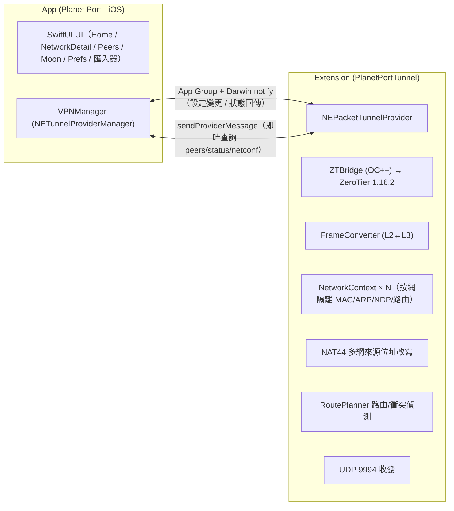

<p align="center">
  
</p>

# Planet Port - iOS 🪐

[简体中文](README.md) | 繁體中文 | [English](README.en.md)

**Planet Port** 是一款開源的 iOS ZeroTier 用戶端，基於 ZeroTier 1.16.2 官方核心構建，以原生 SwiftUI 寫成。它在 iPhone / iPad 上管理行星（Planet）與網路：多顆行星並存，多個網路同時連線，預設路由與 DNS 均可控。

行星的匯入支援檔案、URL、QR Code，分享支援檔案、QR Code；官方 Planet 與自建私有 Planet 在同一首頁左右翻頁，通道隨切換即時生效。

免費開源，可能是目前最好看、也最重視行星管理的 ZeroTier 用戶端，官方 ZeroTier One App 之外的進階之選。

> 非官方用戶端，與 ZeroTier, Inc. 無隸屬關係。

## 緣起

用 ZeroTier 搭自己的私有網路快三年了。最深的感觸是「一次設定，無感使用」——它不打擾，卻又無所不在，到哪都能直連家裡的裝置。

Android 端有 ZerotierFix 可以自訂 Planet，iOS 卻一直缺一個順手的用戶端，想存取家裡網路總是很折騰。索性自己做了這一版，並把行星的管理與分享做得更細，就是現在的 Planet Port。

## 功能

### 行星（Planet）管理

- **多行星並存**：官方 Planet 與多份私有 Planet 一同管理，通道同一時刻只套用一套
- **匯入**：行星檔案、檔案 URL、QR Code。QR Code 為動態分片傳輸，容量自適應，大檔案也傳得動；掃碼支援相機即時掃描與相簿圖片辨識
- **分享**：檔案、QR Code，裝置間互傳只需幾秒
- **行星即世界**：每 Planet 獨立快取，按行星分目錄隔離，切換行星不串資料
- **跨行星切換**：先確認斷開、再啟動新通道，自繪彈窗流程，過程可控
- **查重保護**：按 World ID 去重，同一顆行星無法重複加入

### 網路連線

- **多網路同連**：單一通道承載多個網路，軟上限預設 2 條，可在 2–6 之間調整；超出上限需確認放行
- **衝突自動斷開**：位址或網段衝突自動偵測並斷開，網路卡片直接顯示衝突原因
- **開關即連線**：網路行的開關直接套用通道設定，pending 狀態即時可見
- **狀態細化**：正在初始化 → 連線伺服器 → 線上，每個階段都有明確文案；連線逾時自動斷開（閾值可設定），飛行模式斷網即時提示「無網路」
- **加入網路**：輸入 16 位網路 ID 或掃碼加入，到 [ZeroTier Central](https://my.zerotier.com) 授權新節點後即互通
- **一鍵複製**：managed IP、節點 ID、網路 ID 點擊即複製，網路 ID 另支援 QR Code

### 路由與 DNS

- **預設路由**：「經 ZeroTier 路由」一鍵開關，全部流量走通道
- **DNS 三模式**：使用網路下發 / 自訂 / 不使用
- **熱重配**：路由與 DNS 的全部調整都在通道內完成，不用斷開重連
- **IPv6**：可按需停用

### Peers

- **Peers 即時列表**：延遲按語義色呈現（<30ms 綠 / <100ms 橙 / ≥100ms 紅），無直連路徑時標註「中轉 relay」

### 體驗

- **保持連線**：開啟後網路變化（Wi-Fi 與行動網路切換）自動恢復連線
- **主題自訂**：HSL 色盤自選主色，行星裝飾盤與狀態色由主色全域衍生
- **背景視差**：自訂背景圖，CoreMotion 重力驅動的背景視差動畫。可關閉
- **多語言支援**：目前支援簡體中文、繁體中文、English
- **資料面診斷**：出/入站流量、ARP 問答、無路由丟棄計數與事件日誌，便於定位問題


## 上手使用

1. **加入網路**：首頁新增或選擇一顆行星（官方 Planet 開箱即用）→「新增網路」輸入 16 位網路 ID，或掃碼加入 → 到 ZeroTier Central 授權新節點 → 狀態變「線上」即互通。
2. **切換行星**：匯入私有 Planet（檔案 / URL / QR Code）→ 首頁左右翻頁 → 開啟該行星下的網路開關，通道隨即切換到新行星。
3. **保持連線**：設定頁開啟「保持連線」，網路變化自動恢復連線。

## 截圖

<p align="center">
  
  
  
</p>

## 從原始碼建置

> **系統需求**：iOS 17 及以上。iOS 16 裝置（如 iPhone X）請改用 [ios16 相容分支](https://github.com/planet-port/planet-port-ios/tree/planet-port-ios--ios16) 建置，功能同步維護。

```bash
brew install xcodegen   # 首次
./scripts/bootstrap.sh
open PlanetPort.xcodeproj
```

`bootstrap.sh` 負責拉取 ZeroTier 核心原始碼並產生 Xcode 專案：核心原始碼按固定 tag 下載（含 SHA256 校驗）到 `Core/`（已 gitignore，不入庫），並快取於 `~/Library/Caches/PlanetPort/`，重跑秒過。

下載失敗時有兩個辦法：

```bash
# 改用鏡像
ZT_TARBALL_URL=<鏡像位址> ./scripts/bootstrap.sh

# 或把 tarball 放進快取目錄後重跑（校驗通過即可離線使用）
mkdir -p ~/Library/Caches/PlanetPort
cp ZeroTierOne-1.16.2.tar.gz ~/Library/Caches/PlanetPort/
```

升級 ZeroTier 版本：修改 `scripts/bootstrap.sh` 中的 `ZT_VERSION` 與 `ZT_SHA256` 後重跑。

## 架構



- **行程模型**：App 負責 UI 與 VPN 編排（VPNManager），ZeroTier 1.16.2 C API 跑在通道擴充行程；兩側經 App Group 共享設定，以 Darwin notify 與 sendProviderMessage 雙向通訊
- **行星隔離**：`ZT_STATE_OBJECT_PLANET` 按當前設定重定向；Network / Moon / Peer 核心快取按行星分目錄存放
- **多網路資料面**：單一 tun 承載多網路，NetworkContext 按網路隔離 MAC / 位址 / ARP / NDP / 路由；iOS 單 tun 多位址來源的選源缺陷由 NAT44 在資料面改寫收發位址修復；RoutePlanner 產生通道路由並偵測網段衝突
- **幀語義**：C API 幀不含乙太網路頭（MAC 與 etherType 是獨立參數），FrameConverter 負責與 NEPacketTunnelProvider 的三層 IP 封包互轉，ARP / NDP 為純軟體表

### 目錄

- `Core/` — ZeroTier 1.16.2 核心原始碼（建置時由 `scripts/bootstrap.sh` 按官方 tag 拉取，不入庫）
- `ZTBridge/` — OC++ 橋接層（C API ↔ Swift）
- `PlanetPortTunnel/` — 通道擴充（幀轉換、UDP、背景任務驅動）
- `Shared/` — App 與擴充共用（App Group、設定儲存、IPC 模型、狀態）
- `PlanetPort/` — 主 App（UI、VPNManager、匯入器）
- `Modules/QRTransfer/` — QR Code 分片傳輸

### 延伸閱讀

- [DESIGN.md](DESIGN.md) — 視覺與元件設計錨
- [docs/PlanetPort.md](docs/PlanetPort.md) — 產品結構與頁面職責
- [docs/多网络数据面.md](docs/多网络数据面.md) — 多網路資料面 NAT 設計與已知限制
- [CHANGELOG.md](CHANGELOG.md) — 版本變更記錄

## 致謝與授權

- [ZeroTier](https://github.com/zerotier/ZeroTierOne) — 網路核心，MPL-2.0，授權條款全文見 [docs/licenses/ZeroTierOne-MPL-2.0.txt](docs/licenses/ZeroTierOne-MPL-2.0.txt)
- App 本體採用 [MIT](LICENSE) 授權條款
- 部分動物圖示來自 [Material Design Icons](https://pictogrammers.com/)（Pictogrammers Free License）、[Font Awesome Free](https://fontawesome.com/)（CC BY 4.0，Icons by Font Awesome）與 [game-icons](https://game-icons.info/)（Lorc、Delapouite 等作者，CC BY 3.0）；上述圖示素材均經重新著色與格式轉換

## 捐贈

如果 Planet Port 幫到了你，歡迎請作者喝杯咖啡 ☕

**BTC**（Taproot）

```
bc1p5426677uuazuvfy9fptmczv4zwv550qlu9umw9jyptw5q7ln420qe03ae6
```

**ETH**（Ethereum）

```
0xbaa7a263a95bddb2ff364d1c47e385ed9f54a66a
```

**SOL**（Solana）

```
CFjZhq1dYdQCFKgkhbBwQEzg21WKwoNAm9KZ9uk2nJyf
```
